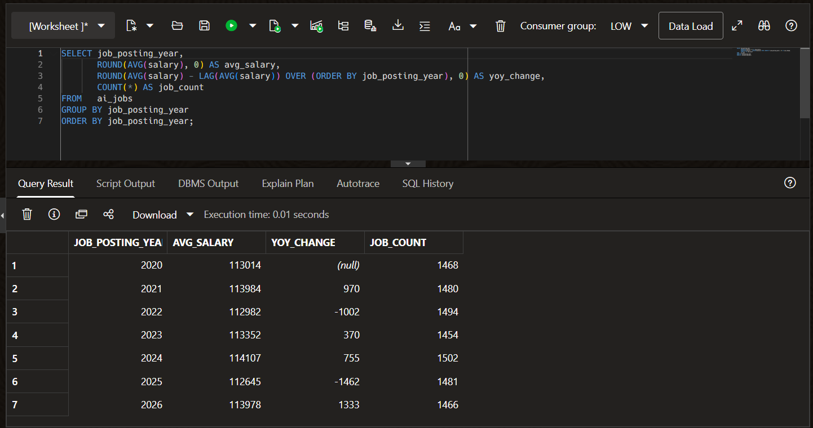
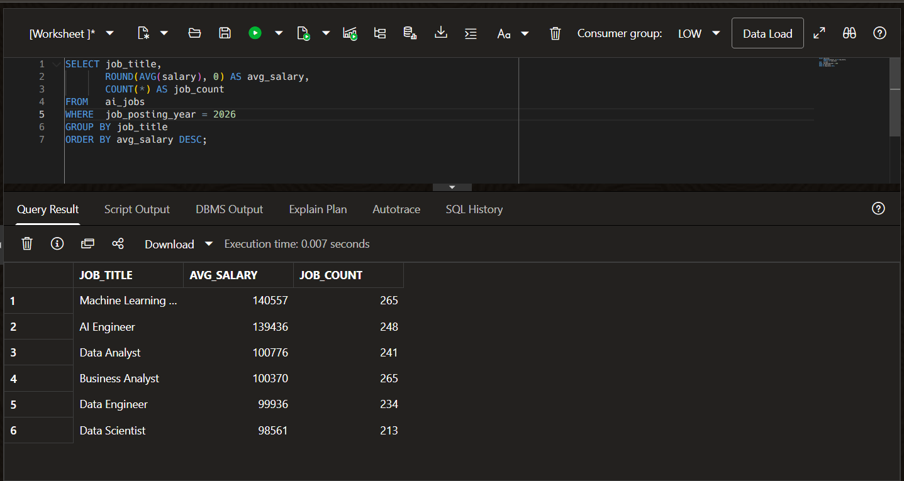
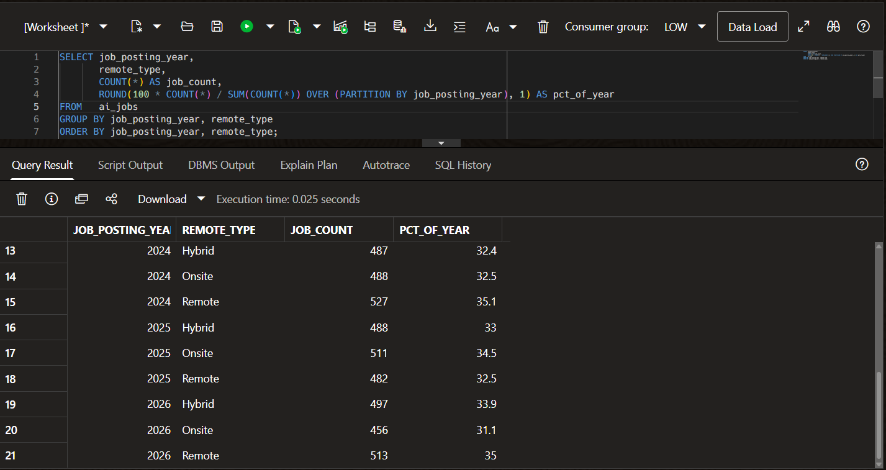

# Job Market Trends Analyzer — AI & Data Science (2020–2026)

A data analysis project exploring job trends, salaries, and in-demand
skills across AI, Machine Learning, and Data Science roles globally
from 2020 to 2026.

## What this project does
- Analyzes salary trends across AI, ML, and Data Science roles
- Tracks how the job market evolved from 2020 to 2026
- Identifies the most in-demand skills by year
- Compares remote vs on-site opportunities across different roles
- Stores the data in an Oracle database and queries it with SQL
- Visualizes findings with Python charts and a Power BI dashboard

## Tools used
- **Python** — data cleaning and analysis (pandas, matplotlib, seaborn)
- **Oracle SQL** — data storage and querying (Oracle Autonomous Database, Always Free tier)
- **Power BI** — interactive dashboard

## Dataset
AI and Data Science Job Market Dataset (2020–2026) from Kaggle
(10,345 job postings).

## Project structure
```
Job-Market-Analyzer/
├── data/                       # Dataset (CSV)
├── charts/                     # Charts generated with Python
├── sql/                        # Oracle SQL scripts and queries
├── dashboard/                  # Power BI build guide
├── screenshots/                # Dashboard and Oracle screenshots
├── Job_Market_Dashboard.pbix   # Power BI dashboard file
├── step1_load_data.py          # Load the data
├── step2 clean data.py         # Clean the data
├── step3_analyse_data.py       # Analyse the data
├── step4_charts.py             # Create charts
└── README.md
```

## Key questions this project answers
1. Which AI and Data Science roles pay the most in 2026?
2. How have salaries changed from 2020 to 2026?
3. Which skills are most in demand right now?
4. How do salaries differ by country and experience level?
5. Is remote work growing or shrinking in AI and Data Science?

## Oracle Database

The dataset is stored in a real Oracle Autonomous Database (Always Free tier on Oracle Cloud).

- `sql/01_create_table.sql` creates the `ai_jobs` table.
- The CSV (10,345 rows) was loaded with the Data Load tool in Oracle Database Actions.
  `sql/02_load_data.ctl` is an equivalent SQL*Loader option for command-line loading.
- `sql/03_analysis_queries.sql` holds the analysis queries.

### Salary trend by year


### Top-paying roles in 2026


### Remote work share by year


The Oracle results match the Power BI dashboard (for example, the 2024 salary peak of about $114K
and Remote staying near a third of postings every year), which cross-checks both parts of the project.

## Power BI Dashboard

An interactive dashboard built on the cleaned dataset (10,345 postings, 2020-2026).
Open `Job_Market_Dashboard.pbix` in Power BI Desktop to explore it.
The build steps are in `dashboard/POWERBI_GUIDE.md`.

### Overview


### Salary by Role


### Skills in Demand


### Remote Work


### Salary by Country


## Key Findings

- **Average salary is about $113K**, and it stays almost flat from 2020 to 2026 (roughly $113K-$114K each year).
- **AI Engineers and Machine Learning Engineers earn the most** (about $140K), while the other four roles sit around $100K.
- **Experience level drives pay more than location**: Senior is about $138K, Mid about $114K and Entry about $89K, with nearly the same gap in every country.
- **Skill demand is evenly spread**: Python, SQL, ML, deep learning and cloud each appear in a similar number of postings.
- **Remote work is stable**: about 34% of postings are remote, and the Remote/Hybrid/Onsite mix barely changes across years.

## Project status
Complete: Python analysis, Oracle database and Power BI dashboard.
