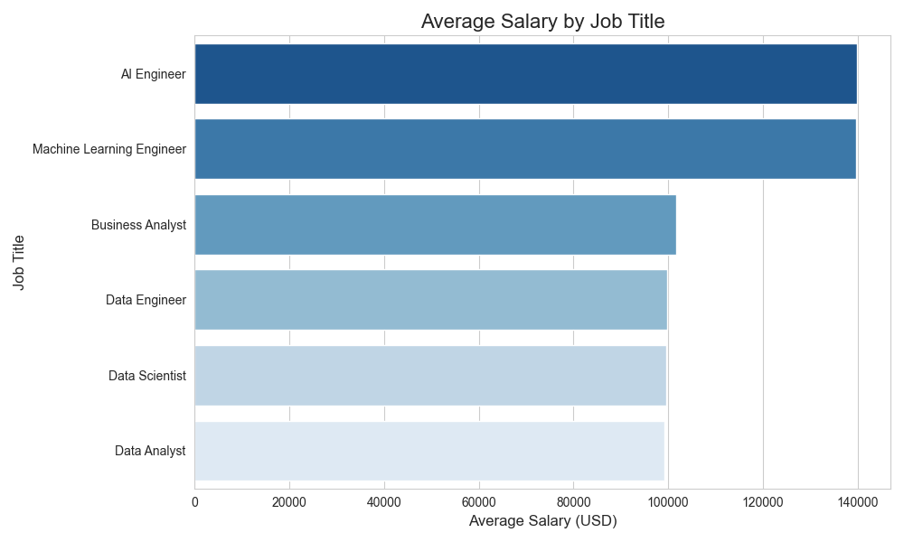
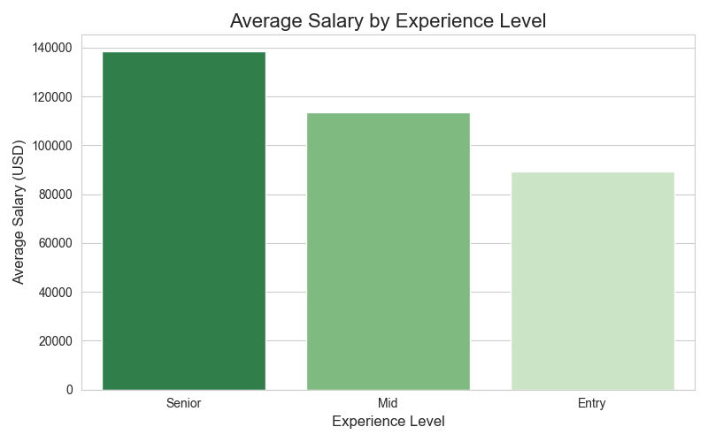
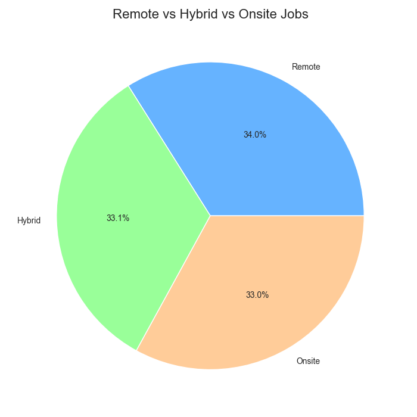
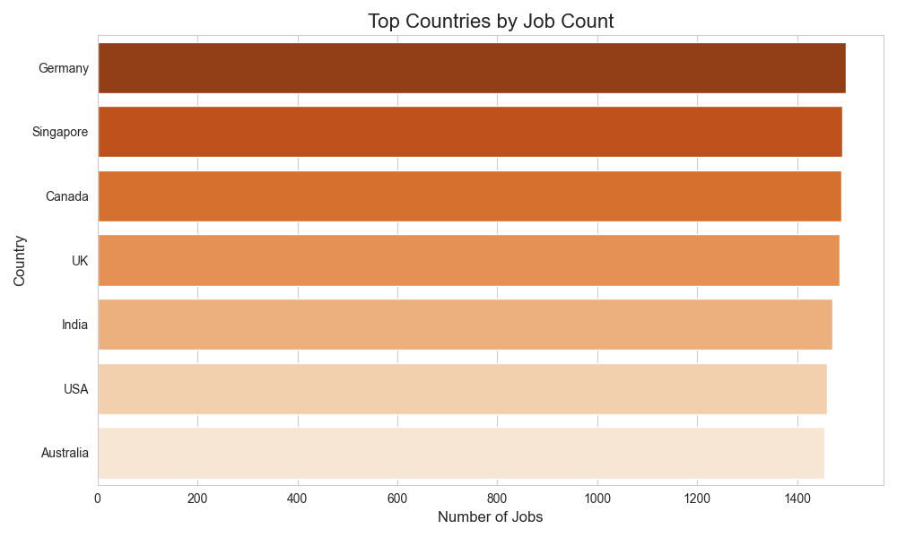

# Job Market Trends Analyzer — AI & Data Science (2020–2026)

A data analysis project exploring job trends, salaries, and in-demand
skills across AI, Machine Learning, and Data Science roles globally
from 2020 to 2026. The data is analysed with Python, stored and queried in
an Oracle database, and presented in a Power BI dashboard.

## What this project does
- Analyzes salary trends across AI, ML, and Data Science roles
- Tracks how the job market evolved from 2020 to 2026
- Identifies the most in-demand skills
- Compares remote, hybrid and on-site opportunities
- Stores the data in an Oracle database and queries it with SQL
- Visualizes findings with Python charts and a Power BI dashboard

## Tools used
- **Python** — data quality checks, exploration and charts (pandas, matplotlib, seaborn)
- **Oracle SQL** — data storage and querying (Oracle Autonomous Database, Always Free tier)
- **Power BI** — interactive dashboard

## Dataset
AI and Data Science Job Market Dataset (2020–2026) from Kaggle,
with 10,345 job postings.

## Project structure
```
Job-Market-Analyzer/
├── data/                       # Dataset (CSV)
├── charts/                     # Charts generated with Python
├── sql/                        # Oracle SQL scripts and queries
├── dashboard/                  # Power BI build guide
├── screenshots/                # Dashboard and Oracle screenshots
├── Job_Market_Dashboard.pbix   # Power BI dashboard file
├── step1_load_data.py          # Load and explore the data
├── step2 clean data.py         # Check data quality
├── step3_analyse_data.py       # Analyse the data
├── step4_charts.py             # Create charts
└── README.md
```

## Key questions this project answers
1. Which AI and Data Science roles pay the most in 2026?
2. How have salaries changed from 2020 to 2026?
3. Which skills are most in demand right now?
4. How do salaries differ by country and experience level?
5. Is remote work growing or shrinking in AI and Data Science?

## Python Analysis
Exploratory analysis and charts made with pandas, matplotlib and seaborn
(`step1` to `step4`).






## Oracle Database
The dataset is stored in a real Oracle Autonomous Database (Always Free tier on Oracle Cloud).

- `sql/01_create_table.sql` creates the `ai_jobs` table.
- The CSV (10,345 rows) was loaded with the Data Load tool in Oracle Database Actions.
  `sql/02_load_data.ctl` is an equivalent SQL*Loader option for command-line loading.
- `sql/03_analysis_queries.sql` holds the
